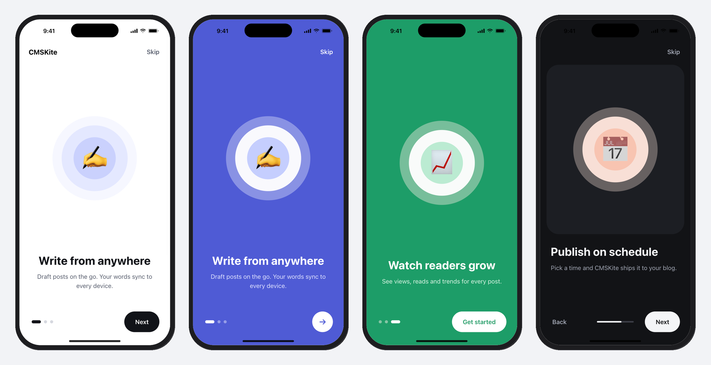
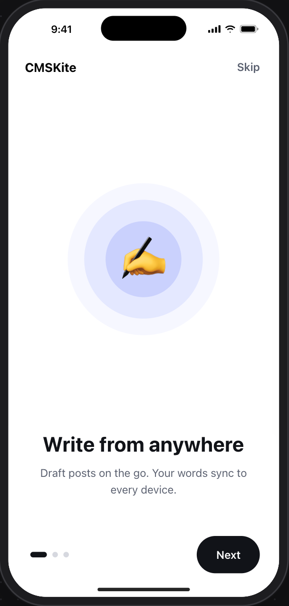
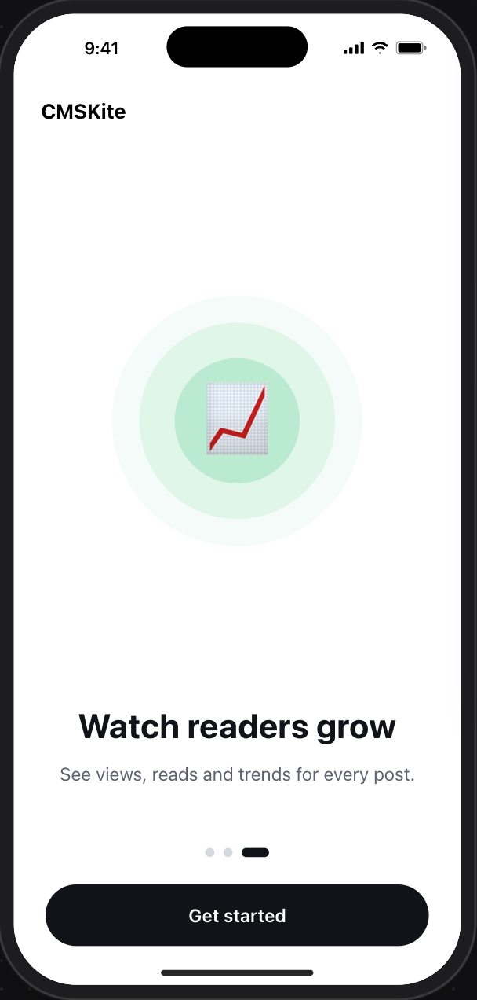
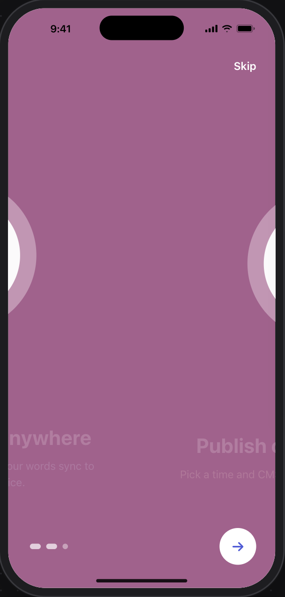
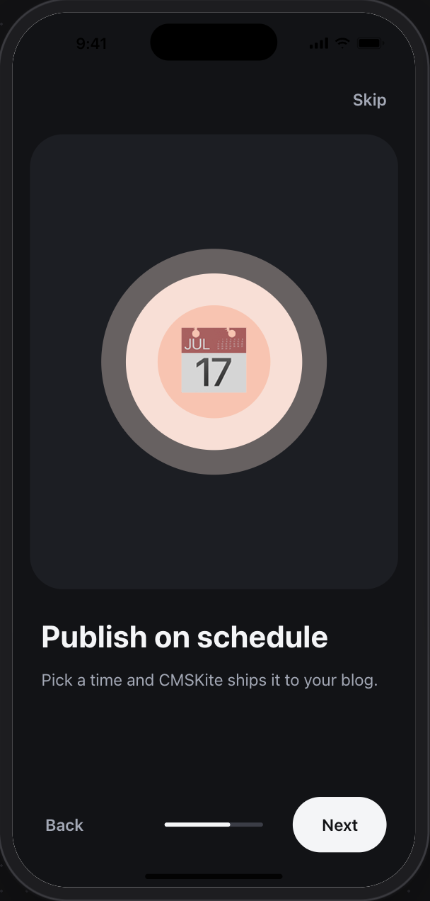

# pyxpo-onboarding

[](https://github.com/pyxpo/pyxpo-onboarding/actions/workflows/ci.yml) [](https://pypi.org/project/pyxpo-onboarding/) [](https://pypi.org/project/pyxpo-onboarding/) [](LICENSE)

Onboarding and intro slides for [pyxpo](https://github.com/pyxpo/pyxpo) apps, written in Python. Give it a list of
pages and it draws a full-screen, swipeable intro with an animated page indicator, Skip / Back / Next / Get started
buttons, parallax on the illustrations and a background that fades between page colors while the user swipes.
Every color, size and part can be changed, and a small hook remembers that the user has seen it.

<p align="center">
  
</p>

```python
from pyxpo_onboarding import Onboarding, OnboardingPage

Onboarding(
    pages=[
        OnboardingPage(title="Write from anywhere", subtitle="Draft posts on the go.", image="asset:write.png"),
        OnboardingPage(title="Publish on schedule", subtitle="Pick a time and we ship it.", image="asset:cal.png"),
        OnboardingPage(title="Watch readers grow", subtitle="Views and trends for every post.", image="asset:grow.png"),
    ],
    on_done=lambda: router.replace("/sign-in"),
)
```

## Features

- **Swipe or tap:** pages snap one at a time. Next, Back, Skip and Get started buttons move between them, and the
  Android back button goes to the previous page first.
- **Moves with the finger:** the indicator, the screen background, the button color, the illustration parallax and
  the text fade all follow the scroll position on the native thread, so they stay smooth while Python is busy.
- **Six indicators:** `expanding` (default), `dot`, `scale`, `line`, `number` and `none`. Dots are tappable.
- **Two layouts:** `center` (art above centered text) and `card` (art on a rounded backdrop, left-aligned text).
- **Three Next buttons:** `pill` (default), `circle` (an arrow) and `text`. The last page shows a full-width
  Get started button, or a pill when `full_width_done=False`.
- **Per-page colors:** each page can set its own background, title, subtitle and accent colors. The screen blends
  between them during a swipe.
- **Theming:** `OnboardingTheme` holds every color and size, with light and dark defaults that follow the system.
  Pass `"light"`, `"dark"`, a dict of changes, your own theme, or one per scheme.
- **Replace any part:** `render_page`, `render_indicator`, `render_skip`, `render_back`, `render_next`,
  `render_done` and `render_footer` swap in your own components; `header` adds a logo at the top.
- **Control from code:** `ref.current` has `next()`, `back()`, `go_to(i)`, `skip()`, `done()` and `index`.
- **Show it once:** `use_onboarding_seen()` stores a "seen" flag with pyxpo-storage. Bump `version` to show a
  redesigned intro again.
- **Accessible:** titles are headers, buttons have labels, and the indicator reads "Page 2 of 3".

## Contents

- [Platform support](#platform-support)
- [Install](#install)
- [Quick start](#quick-start)
- [Pages](#pages)
- [Looks](#looks)
- [Theming](#theming)
- [Buttons and behavior](#buttons-and-behavior)
- [Custom parts](#custom-parts)
- [Controlling it from code](#controlling-it-from-code)
- [Show it once](#show-it-once)
- [Recipe: onboarding before sign-in](#recipe-onboarding-before-sign-in)
- [Testing](#testing)
- [Troubleshooting](#troubleshooting)
- [API reference](#api-reference)

## Platform support

| Target | Onboarding |
| --- | --- |
| Android, iOS | Everything. Animations run on the native thread. |
| Web page and desktop window (`pyxpo run web` / `pyxpo run desktop`) | Everything. Pages snap with CSS scroll snapping; the indicator and colors follow each scroll event. |

Requires Python 3.9+ and `pyxpo>=0.1.0a4`. `use_onboarding_seen` also needs `pyxpo-storage`.

## Install

```sh
pip install pyxpo-onboarding            # or 'pyxpo-onboarding[storage]' for use_onboarding_seen
```

Add the module to your app's `pyproject.toml`, so the build bundles its Python files:

```toml
[tool.pyxpo]
modules = ["onboarding", "storage"]     # "storage" only if you use use_onboarding_seen
```

The module has no native code and no config plugin. Rebuild once after adding it.

## Quick start

```python
from pyxpo import component
from pyxpo_onboarding import Onboarding, OnboardingPage

PAGES = [
    OnboardingPage(title="Write from anywhere", subtitle="Draft posts on the go. Your words sync to every device.",
                   image="asset:onboarding/write.png"),
    OnboardingPage(title="Publish on schedule", subtitle="Pick a time and CMSKite ships it to your blog.",
                   image="asset:onboarding/schedule.png"),
    OnboardingPage(title="Watch readers grow", subtitle="See views, reads and trends for every post.",
                   image="asset:onboarding/grow.png"),
]


@component
def Intro(on_finish):
    return Onboarding(pages=PAGES, on_done=on_finish)
```

The screen fills its parent and handles the safe area itself, so render it as a whole screen.

## Pages

`OnboardingPage` fields (all optional). A plain dict with the same keys works too.

| Field | What it does |
| --- | --- |
| `title`, `subtitle` | A string, or your own element for rich text. |
| `image` | An element (an `Svg`, a Lottie view, your own `View`) or an image source: a path, `asset:name`, an http(s) URL or `{"uri": ...}`. |
| `background` | The screen color while this page is showing. Blends with the next page's color during a swipe. |
| `title_color`, `subtitle_color` | Text colors for this page. |
| `accent`, `on_accent` | The Next button and active-dot color, and the button's text color. |
| `backdrop` | The art card's color in the `card` layout. |
| `content` | An element that replaces the whole page body. |
| `key` | A stable key, when pages change at runtime. |

## Looks

<p align="center">
  
  
  
  
</p>

The default: light or dark from the system, `expanding` dots, a pill Next button and a full-width Get started.

```python
Onboarding(pages=PAGES, header=Text("CMSKite", style={"font_size": 18, "font_weight": "700"}))
```

Colored pages with a round arrow button (second and third screens in the image at the top):

```python
PAGES = [
    OnboardingPage(title="Write from anywhere", subtitle="...", image=..., background="#4f5bd5",
                   title_color="#ffffff", subtitle_color="#e2e5ff", accent="#ffffff", on_accent="#4f5bd5"),
    OnboardingPage(title="Publish on schedule", subtitle="...", image=..., background="#f06a43",
                   title_color="#ffffff", subtitle_color="#ffe3d9", accent="#ffffff", on_accent="#f06a43"),
    ...
]
Onboarding(pages=PAGES, next_style="circle", full_width_done=False,
           theme={"muted": "#ffffff66", "skip_color": "#ffffff"})
```

The card layout, dark, with a progress line and a Back button:

```python
Onboarding(pages=PAGES, layout="card", indicator="line", show_back=True, theme="dark")
```

| Option | Values |
| --- | --- |
| `indicator` | `"expanding"`, `"dot"`, `"scale"`, `"line"`, `"number"`, `"none"` |
| `layout` | `"center"`, `"card"` |
| `next_style` | `"pill"`, `"circle"`, `"text"` |
| `full_width_done` | `True` (a wide Get started button under the indicator) or `False` (same place as Next) |
| `parallax` | How far the art lags behind the text, `0` to turn it off. Default `0.35`. |
| `animate_text` | Fade and slide the text during a swipe. Default `True`. |

## Theming

`theme` takes any of these:

```python
Onboarding(pages=PAGES)                                   # light or dark, from the system
Onboarding(pages=PAGES, theme="dark")                     # always dark
Onboarding(pages=PAGES, theme={"accent": "#4f5bd5"})      # change some fields of the system default
Onboarding(pages=PAGES, theme=LIGHT.merge(title_size=34, font_family="Inter"))
Onboarding(pages=PAGES, theme={"light": {"accent": "#4f5bd5"}, "dark": DARK.merge(accent="#9aa3ff")})
```

`OnboardingTheme` fields:

| Field | Default (light) | Used for |
| --- | --- | --- |
| `background` | `#ffffff` | Screen color when a page sets none |
| `title_color`, `subtitle_color` | `#111318`, `#5b6170` | Text |
| `accent`, `on_accent` | `#111318`, `#ffffff` | Next / Get started button and active dot |
| `muted` | `#d5d8df` | Inactive dots and the line track |
| `skip_color` | `#5b6170` | Skip and Back |
| `backdrop` | `#f2f3f6` | Art card in the `card` layout |
| `title_size`, `title_weight`, `title_line_height` | `30`, `"700"`, `36` | Title |
| `subtitle_size`, `subtitle_line_height` | `16`, `24` | Subtitle |
| `font_family` | `None` | All text |
| `horizontal_padding` | `28` | Side padding |
| `button_height`, `button_radius` | `54`, `27` | Buttons |
| `dot_size`, `dot_active_width`, `dot_gap` | `8`, `24`, `8` | Dots |
| `line_width`, `line_height` | `96`, `4` | The `line` indicator |
| `illustration_ratio` | `0.52` | Art height as a share of the screen height |
| `extra` | `{}` | Your own values, for `render_*` functions |

Page colors win over the theme. For one-off style changes use `style`, `title_style`, `subtitle_style`,
`button_style` and `button_text_style`.

## Buttons and behavior

| Prop | Default | What it does |
| --- | --- | --- |
| `on_done` | `None` | Called by Get started, and by Skip when `on_skip` is not set. |
| `on_skip` | `None` | Called by Skip. |
| `on_change` | `None` | Called with the new page index after each move. |
| `skip_to_end` | `False` | Skip jumps to the last page instead of finishing. |
| `show_skip`, `show_back`, `show_next` | `True`, `False`, `True` | Show or hide each button. Skip hides itself on the last page, Back on the first. |
| `skip_label`, `back_label`, `next_label`, `done_label` | `"Skip"`, `"Back"`, `"Next"`, `"Get started"` | Button text, for other languages. |
| `initial_index` | `0` | The page to open on. |
| `swipe_enabled` | `True` | `False` moves only with the buttons. |
| `handle_back_button` | `True` | Android back goes to the previous page; on the first page it does nothing, so your screen handles it. |
| `safe_area` | `True` | Pad for the notch and the home indicator. |

## Custom parts

Every `render_*` function gets an `OnboardingState`: `index`, `count`, `page`, `pages`, `theme`, `accent`,
`on_accent`, `is_first`, `is_last`, `progress` (the animated scroll position in pages) and the actions `next`,
`back`, `skip`, `done` and `go_to(i)`.

```python
from pyxpo import Pressable, Text

def my_done(state):
    return Pressable(Text("Let's go", style={"color": "#fff", "font_weight": "700"}), on_press=state.done,
                     style={"background_color": state.accent, "padding": 16, "border_radius": 12})

def my_page(page, i, state):                 # replaces the whole page body
    return MyHeroPage(page.title, step=i + 1)

Onboarding(pages=PAGES, render_done=my_done, render_page=my_page, header=Logo())
```

`state.progress` is an animated node, so your own parts can move with the finger too:

```python
from pyxpo import Animated

def bar(state):
    width = state.progress.interpolate([0, state.count - 1], [40, 240], extrapolate="clamp")
    return Animated.View(style={"width": width, "height": 4, "background_color": state.accent})

Onboarding(pages=PAGES, render_indicator=bar)
```

`Indicator(kind, count, index, progress, theme, active, inactive)` is the built-in indicator, if you build your own
footer with `render_footer` and want to reuse it.

## Controlling it from code

```python
from pyxpo import use_ref

ref = use_ref(None)
Onboarding(pages=PAGES, ref=ref)

ref.current.next()            # or back(), go_to(2), go_to(2, animated=False), skip(), done()
ref.current.index             # the page showing now
```

## Show it once

```python
from pyxpo_onboarding import use_onboarding_seen

seen = use_onboarding_seen()              # (seen, mark_seen, reset)
seen = use_onboarding_seen(version=2)     # a new flag: everybody sees the redesigned intro once
```

`seen.seen` is a bool, `seen.mark_seen()` stores it, `seen.reset()` clears it. The flag lives in pyxpo-storage
under `pyxpo.onboarding.seen` (with `.v<version>` added when you pass one). Pass `key=` for your own name or
`storage=` for your own `Storage` instance.

## Recipe: onboarding before sign-in

```python
from pyxpo import component
from pyxpo_onboarding import Onboarding, use_onboarding_seen

@component
def Root():
    seen = use_onboarding_seen()
    if not seen.seen:
        return Onboarding(pages=PAGES, on_done=seen.mark_seen)
    return SignInScreen()
```

`mark_seen` updates the hook's state, so the screen switches to sign-in right away and stays there on the next
launch.

## Testing

The screen runs under pyxpo's `MockRenderer`, so tests need no device:

```python
from pyxpo import LocalChannel
from pyxpo.app import create_app
from pyxpo.renderers.mock import MockRenderer

def test_get_started_finishes():
    done = []
    ch = LocalChannel()
    r = MockRenderer(ch)
    create_app(lambda: Onboarding(pages=PAGES, width=360, initial_index=2, on_done=lambda: done.append(1)), ch)
    r.press(r.find_text("Get started"))
    assert done == [1]
```

Pass `width` so page offsets are known. A swipe is `r.emit("momentum_scroll_end", r.find_all("ScrollView")[0],
{"value": {"x": 720, "y": 0}})`.

## Troubleshooting

| Problem | Cause and fix |
| --- | --- |
| `ImportError: use_onboarding_seen needs pyxpo-storage` | Install `pyxpo-onboarding[storage]` and add `"storage"` to `modules`. |
| `ValueError: indicator must be one of ...` | A misspelled `indicator`, `layout` or `next_style`. The message lists the valid values. |
| `ValueError: Onboarding needs at least one page` | `pages` was empty. |
| Images do not show | An `asset:` name that is not in the app's assets, or a remote URL without network. Elements (`Svg`, `View`) always work. |
| The art is cut off on small phones | Lower `illustration_ratio` in the theme; the art also shrinks by itself before the text is clipped. |
| The intro shows on every launch | `mark_seen()` is never called, or `"storage"` is missing from `modules` so nothing is saved. |

## API reference

| Name | What it is |
| --- | --- |
| `Onboarding(pages, ...)` | The screen component. Props are listed above. |
| `OnboardingPage(...)` | One page. |
| `OnboardingTheme(...)`, `LIGHT`, `DARK` | Theme dataclass and the two defaults. `theme.merge(**changes)` returns a copy. |
| `resolve_theme(theme, scheme)` | Turns any `theme` value into an `OnboardingTheme`. |
| `OnboardingState` | What `render_*` functions get. |
| `OnboardingHandle` | `ref.current`: `index`, `next()`, `back()`, `go_to(i, animated=True)`, `skip()`, `done()`. |
| `Indicator(...)` | The built-in indicator. |
| `use_onboarding_seen(key=..., version=None, storage=None)` | Returns `SeenFlag(seen, mark_seen, reset)`. |
| `INDICATORS`, `LAYOUTS`, `NEXT_STYLES` | The valid option values. |

## License

MIT.
